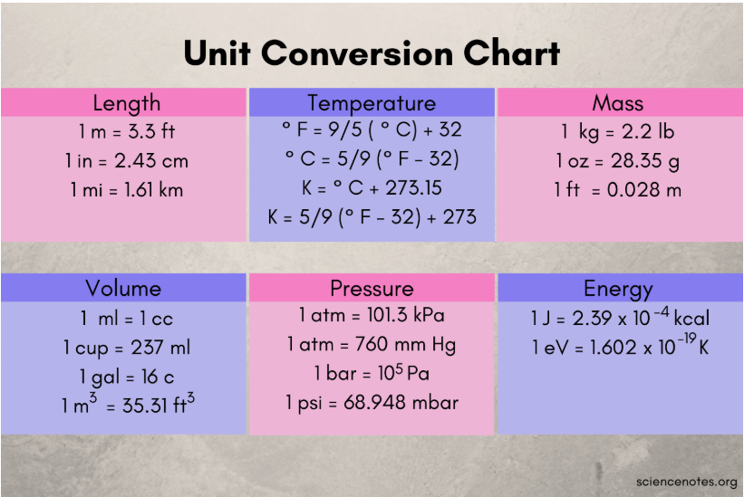

# Week 3 – Functions and Modules – Programming Problems

## Task 1: Quiz
Suppose you want to develop a program to help a first grader practice addition, subtraction, multiplication, division, exponent or remainder. The user should have the option of choosing which mathematical operation they wish to practice. The program randomly generates two single-digit integers, number1 and number2, and of course the user will provide the answer to the question.

The program should include:
- A menu allowing the student to choose the operation they want to practice (ideally included in function names or main).
- Functions for each of the mathematical operations.
- A score calculating correct answers.
- Error messages for situations such as division by zero.
- Functionality to keep practicing until the user decides otherwise.

## Task 2: Scientific Calculator (Unit Conversion Chart)
Create a Scientific Calculator imitating the Unit Conversion Chart (Fig. 1).

Allow the user to choose between length, temperature, mass, volume, pressure, and energy. Create separate functions for each calculation within the types of unit. Allow the user to choose between units. For example, if the user chooses length, then the programme should allow the user to choose between conversions: m/ft, in/cm, or mi/km. The user should then enter the value to calculate. Finally, the system should do the conversion and print out the result.



*Fig 1. Unit Conversion Chart*

## Task 3: Palindrome Checker
Write a function to check if a given string is a palindrome (reads the same backward as forward).

Some palindrome words are: civic, radar, level, rotor, kayak, madam, refer, rotator, deified, racecar and reviver.

The function should take one string, and return `True` if it is a palindrome, otherwise `False`.

## Task 4: Text Compression
Write a Python function called `compress_string` that takes a string as input and returns a compressed version of the string. The compression should replace repeated characters with the character followed by the count of repetitions. If the compressed string is longer than the original string, return the original string.

```python
compressed = compress_string("aaabbbbcccddeee")
# The expected output is "a3b4c3d2e3" because 'a' is repeated 3 times, 'b' 4 times, 'c' 3 times, etc.
compressed = compress_string("Hello")
# The expected output is "Hello", because the compressed string in this case H1e1l2o1 is longer than the original string "Hello"
```

## Task 5: Lambda Rewrite
Rewrite the quiz or the scientific converter including mainly lambda functions.

## Task 6: Cyber: Timestamped Auth Event
Ask for a username and action (e.g., `LOGIN` or `LOGOUT`) and print a timestamped event line.

**Example Output:**
```
[2025-09-17 14:20:15] LOGIN user=alice
```
*Optional hint:* `from datetime import datetime; datetime.now().strftime(...)`

## Task 7: Pure Python EDA: Mini Statistics Report
Ask for five numeric values (space-separated). Print the values, total, mean, median, and sample standard deviation.

**Example Output:**
```
Values: 80, 90, 70, 85, 75
Total = 400.00
Mean = 80.00
Median = 80.00
Std Dev = 7.91
```
*Optional hint:* `import statistics as stats`

## Task 8: IT: Path Decomposition Report
Ask for a file or directory path and print its absolute path, parent, name, stem, and suffix.

**Example Output:**
```
Absolute path: /home/user/project/service.log
Parent: /home/user/project
Name: service.log
Stem: service
Suffix: .log
```
*Optional hint:* `from pathlib import Path`

## Task 9: System Info Banner
Ask for a hostname and print OS and Python version as a simple banner (one value per line).

**Example Output:**
```
Host: server01
OS: Linux
Python: 3.11.5
```
*Optional hint:* `import platform; platform.system(); platform.python_version()`

## Task 10: Pentagon Area
Ask for the side length `s` and compute the area: `area = 5*s**2 / (4*tan(pi/5))`. Print to 2 d.p.

**Example Output:**
```
Area = 172.05
```
*Optional hint:* `from math import tan, pi`

## Task 11: Square Root Table
Use the `math.sqrt` function. Write a program that prints the following table using the `sqrt` function in the `math` module.

```
Number      Square root
0   	 	0.00
2    		1.41
4    		2.00
6    		2.45
8    		2.83
10    		3.16
12    		3.46
14    		3.74
16    		4.00
18    		4.24
```
